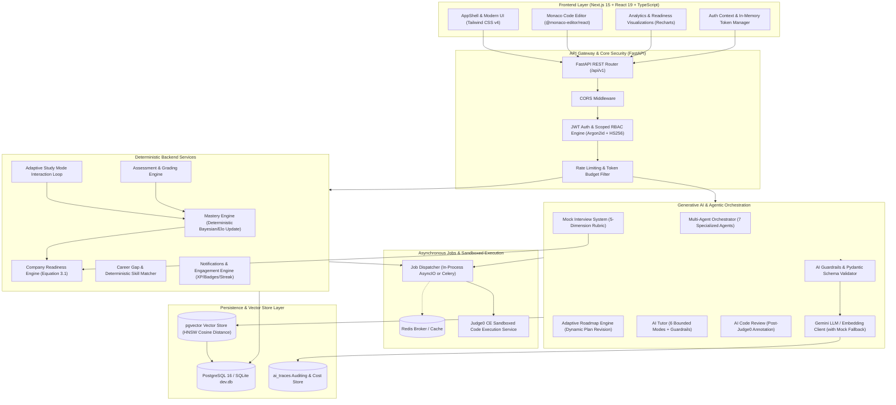

# Document 2: Complete System Architecture

> **Focus**: Ground-Up Architectural Decomposition, Inter-Subsystem Communication, and End-to-End Request Tracing  
> **Source Repository Location**: `major1/`  
> **Architecture Style**: Modular Monolith with Asynchronous Sandbox and Vector Decoupling  

---

## 1. System Topology Overview

PrepPath is designed as a **Modular Monolith** rather than a set of distributed microservices. This choice provides the rapid development and strict data-consistency guarantees required for an academic project while cleanly decoupling resource-intensive operations (code execution and vector embeddings) into asynchronous workers and isolated sandboxes.

```text
┌────────────────────────────────────────────────────────────────────────────────────────┐
│                                 PRESENTATION LAYER                                     │
│  Next.js 15.1 (App Router) · React 19 · TypeScript · Tailwind CSS v4 · Monaco · Recharts│
│  In-Memory Access Token Storage · Automatic 401 Session Refresh with Replay Wrapper     │
└───────────────────────────────────────────┬────────────────────────────────────────────┘
                                            │ HTTP / JSON (CORS, Bearer Auth)
                                            ▼
┌────────────────────────────────────────────────────────────────────────────────────────┐
│                              API GATEWAY & SECURITY LAYER                              │
│  FastAPI (Async) · Pydantic v2 · CORS Middleware · Scoped RBAC Engine (Argon2id + JWT) │
│  Per-User Rate Limiting (12 req/min) · Daily AI Token Budget Enforcement (150k)       │
└───────────────────────────────────────────┬────────────────────────────────────────────┘
                                            │
                 ┌──────────────────────────┴──────────────────────────┐
                 ▼                                                     ▼
┌──────────────────────────────────────────────┐      ┌──────────────────────────────────┐
│         DETERMINISTIC SERVICE LAYER          │      │     BOUNDED GENERATIVE AI LAYER  │
│ • Mastery Engine (Bayesian/Elo Update)       │      │ • 7 Bounded Agent Orchestrator   │
│ • Readiness Engine (Equation 3.1)            │      │ • Dynamic Roadmap Revision Engine│
│ • Test Assessment & Grading Engine           │      │ • RAG AI Tutor (6 Bounded Modes) │
│ • Career Skill Matcher (Alias Normalizer)    │      │ • AI Code Review (Post-Judge0)   │
│ • Notifications & Engagement (XP, Badges)    │      │ • Mock Interview (5 Rubrics)     │
└──────────────────────┬───────────────────────┘      └────────────────┬─────────────────┘
                       │                                               │
                       ▼                                               ▼
┌──────────────────────────────────────────────┐      ┌──────────────────────────────────┐
│      PERSISTENCE & DATA STORAGE LAYER        │      │    EXTERNAL SANDBOX & AI APIS    │
│ • PostgreSQL 16 (Relational DB)              │      │ • Judge0 CE Sandbox Engine       │
│ • pgvector Extension (768-d HNSW Vector Index)│      │   (Isolated Code Execution)      │
│ • SQLite fallback (dev.db with in-Python cos)│      │ • Google Gemini API (Flash/Lite) │
│ • Redis 7 (Broker & Response Cache)          │      │ • Deterministic Mock Fallbacks   │
└──────────────────────────────────────────────┘      └──────────────────────────────────┘
```

---

## 2. Layer-by-Layer Architectural Decomposition

### 2.1 Layer 1: Frontend Client Layer
- **What is it?**: A single-page, server-rendered and client-hydrated web application built on Next.js 15.1 (App Router) and React 19.
- **Why does it exist?**: To provide students with a responsive, low-latency interface for code editing, interactive chat, real-time assessment timers, and animated analytics charts.
- **Core Responsibilities**:
  - Routing: Static and dynamic pages under `src/app/(app)/`.
  - State Management: In-memory access token storage in `src/lib/api.ts` with React Context.
  - Code Editing: VS Code core editor integration via `@monaco-editor/react`.
  - Visualizations: Interactive line charts, horizontal readiness bars, and distribution histograms using `recharts`.
- **Inter-layer Communication**: Communicates exclusively via asynchronous HTTP requests (`fetch`) to `/api/v1` endpoints with JSON payloads.
- **Implementation Path**: `frontend/src/`

### 2.2 Layer 2: API Gateway & Security Layer
- **What is it?**: An asynchronous REST API application built with FastAPI (Python 3.12).
- **Why does it exist?**: To serve as the single entry point for client requests, validating incoming data structures, verifying authentication, and enforcing permissions before executing business logic.
- **Core Responsibilities**:
  - Request validation using Pydantic v2 schemas (`app/schemas/`).
  - CORS header enforcement for `localhost:3000` and production domains.
  - Security dependency injection: `app/core/deps.py` enforcing scopes (`me`, `content:write`, `admin:panel`).
  - Rate limiting and daily token budgeting (`app/core/ratelimit.py`, `app/services/llm.py`).
- **Implementation Path**: `backend/app/main.py`, `backend/app/core/`

### 2.3 Layer 3: Deterministic Service Layer
- **What is it?**: Pure Python domain services that execute core business logic without relying on probabilistic AI outputs.
- **Why does it exist?**: To guarantee that code evaluations, student grades, mastery calculations, and readiness scores are 100% reproducible, mathematically auditable, and unit-testable.
- **Core Responsibilities**:
  - **Mastery Engine (`app/services/mastery.py`)**: Computes skill updates:
    $$\Delta = \text{clamp}\left(\text{lr} \cdot w \cdot (\text{target} - \text{mastery}), -15, 15\right)$$
  - **Readiness Engine (`app/services/readiness_data.py`, `readiness.py`)**: Computes Equation 3.1:
    $$\text{CRS} = 0.25 \cdot \text{DSA} + 0.20 \cdot \text{CSF} + 0.20 \cdot \text{Coding} + 0.15 \cdot \text{Aptitude} + 0.10 \cdot \text{Interview} + 0.10 \cdot \text{Consistency}$$
  - **Grading Service (`app/services/grading.py`)**: Applies question marks, negative penalties, and section time rules.
  - **Career Matcher (`app/services/career.py`)**: Normalizes skills (e.g. `psql` $\to$ `postgresql`) and calculates deterministic match percentages.
- **Implementation Path**: `backend/app/services/`

### 2.4 Layer 4: Bounded Generative AI Layer
- **What is it?**: An AI subsystem powered by Google Gemini APIs, structured around 7 specialized agents and a strict guardrail pipeline.
- **Why does it exist?**: To provide pedagogical guidance (Socratic tutoring, worked examples, mock interviews, and personalized study roadmaps) without the hallucinations or unreliability of raw LLMs.
- **Core Responsibilities**:
  - **Multi-Agent Orchestrator (`app/services/agents/orchestrator.py`)**: Routes student requests through a central Triage Agent to 6 specialized agents.
  - **AI Tutor (`app/services/tutor.py`)**: Manages 6 bounded modes (Explain, Hint, Interviewer, Evaluate, Follow-up, Revision).
  - **AI Code Review (`app/services/code_review.py`)**: Evaluates complexity and potential defects *only after* Judge0 returns an authoritative verdict.
  - **Mock Interview Engine (`app/services/interview.py`)**: Manages conversational interview turns and grades across a 5-dimension rubric on a 1–10 scale.
  - **Guardrails (`app/services/guardrails.py`)**: Strips prompt injections, checks source citations, and prevents hint answer leakage.
- **Implementation Path**: `backend/app/services/`

### 2.5 Layer 5: Asynchronous Task & Sandboxed Execution Pipeline
- **What is it?**: An asynchronous background execution infrastructure decoupling long-running jobs (code compilation, text extraction, embedding generation) from client HTTP requests.
- **Why does it exist?**: Compiling C++ or executing Judge0 test suites takes 1–3 seconds. Running this synchronously inside a web request would block worker threads and lead to request timeouts.
- **Core Responsibilities**:
  - Job Dispatcher (`app/services/jobs.py`): Enqueues tasks to Celery when `REDIS_URL` is configured, or runs them in-process via `asyncio.create_task` during local development.
  - Judge0 CE Client (`app/services/judge.py`): Submits multi-test batches to an isolated Judge0 container over HTTP. Collects status codes (3: Accepted, 4: WA, 5: TLE, 6: CE, 7: RE) and aggregates verdicts prioritizing errors.
- **Implementation Path**: `backend/app/services/judge.py`, `backend/app/services/jobs.py`, `backend/app/worker.py`

### 2.6 Layer 6: Persistence & Vector Layer
- **What is it?**: High-performance relational and vector persistence systems managed via SQLAlchemy 2.0 Async ORM and Alembic migrations.
- **Why does it exist?**: To persist relational domain entities (users, questions, attempts, submissions, readiness snapshots) and high-dimensional semantic embeddings for RAG search.
- **Core Technologies**:
  - **PostgreSQL 16**: Primary relational database with ACID guarantees.
  - **pgvector**: Stores 768-dimensional document chunk embeddings with an HNSW index for sub-millisecond cosine distance lookups.
  - **SQLite Fallback (`dev.db`)**: Used during local development and automated testing (`aiosqlite`), storing embeddings as JSON lists and computing cosine distance in pure Python (`app/services/rag.py:_cos`).
- **Implementation Path**: `backend/app/models/`, `backend/app/core/db.py`, `backend/alembic/`

---

## 3. Comprehensive Architecture Diagram

The complete system diagram is stored at [`major1/docs/viva_preparation/diagrams/System_Architecture.mmd`](file:///c:/Users/Asus/Documents/Major%20project/major1/docs/viva_preparation/diagrams/System_Architecture.mmd):



---

## 4. End-to-End Execution Trace: Opening a Company-Specific Study Session

To demonstrate how these architectural layers collaborate in production, consider a real scenario: **A student selects "Binary Search Trees" for an Amazon preparation study session.**

```text
Sequence of Execution:
Step 1: Frontend Request
  └── User clicks "Study Binary Search Trees" in the Amazon Company Portal
  └── Client dispatches HTTP POST /api/v1/study/sessions {topic_id: 12, company_id: 1}
  └── Headers include: Authorization: Bearer <in-memory-access-token>

Step 2: API Gateway & Security Processing
  └── FastAPI routes request to app/routers/study.py:create_session()
  └── Dependency require_scopes("me") validates JWT signature, expiration, and user role
  └── Rate limiter checks current request frequency (12 req/min limit)

Step 3: Deterministic Initial Question Selection
  └── Query mastery table for user_id and skill_id corresponding to topic 12
  └── app/services/mastery.py:target_difficulty() determines starting difficulty:
      • If mastery < 35 -> "easy"
      • If 35 <= mastery < 70 -> "medium"
      • If mastery >= 70 -> "hard"
  └── Query questions table for published question matching topic_id and difficulty
  └── Strip confidential answers and hidden test cases
  └── Create Attempt record (mode="study", status="in_progress") in database
  └── Return session details and diagnostic question to frontend

Step 4: Student Submits Answer & Confidence
  └── Student selects option B and rates confidence as 4 out of 5
  └── Client posts to POST /api/v1/study/sessions/{id}/answer
  └── Backend writes Submission and Verdict records (is_correct=False)

Step 5: RAG AI Tutor Serves Grounded Explanation
  └── Client requests GET /api/v1/study/sessions/{id}/teaching?kind=explanation
  └── app/services/tutor.py:teach_topic() calls app/services/rag.py:search()
  └── Search vectorizes query via Gemini embedding-001 (768 dimensions)
  └── pgvector performs cosine distance search against documents table:
      • +0.05 boost applied for matching topic_id
      • +0.05 boost applied for matching company_id (Amazon)
      • Similarity floor >= 0.55 enforced
  └── Top 4 grounded chunks returned with citation keys [S12, S15]
  └── LLM called with structured ExplainOut schema (Pydantic validation)
  └── Guardrails verify that every cited [S#] exists in retrieved chunks
  └── AI usage logged to ai_traces table (latency, tokens, estimated cost)
  └── Explanation with verified citation chips returned to frontend

Step 6: Socratic Worked Example & Mini-Quiz
  └── Client requests kind=worked_example -> Tutor serves numbered reasoning steps
  └── Student completes adaptive follow-up mini-quiz

Step 7: Session Completion & Deterministic Mastery Update
  └── Student finishes session -> POST /api/v1/study/sessions/{id}/complete
  └── app/services/mastery.py:update_mastery() calculates score delta:
      • Applies learning rate decay lr = max(0.15, 1/(attempt_count + 2))
      • Applies incorrect weight w = 2.0 - difficulty_weight
      • Misconception penalty applied because student had high confidence (4/5) but answered incorrectly!
      • Delta clamped to [-15.0, 15.0] points
  └── UPSERT into mastery table with new mastery_score and accuracy
  └── Updated mastery feeds directly into Equation 3.1 Company Readiness Score
  └── Frontend updates progress bar and renders completion summary
```
