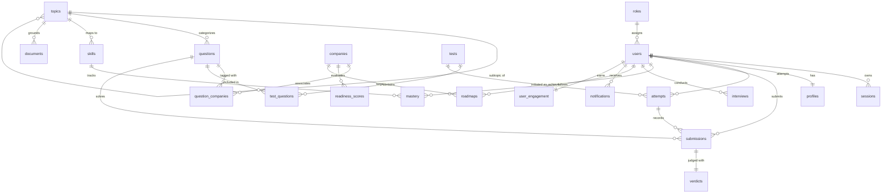

# Document 6: Database Architecture and Data Flow

> **Focus**: Entity-Relationship Topology, Schema Design, Foreign Key Cascades, and End-to-End Data Lifecycle  
> **Source Repository Location**: `major1/backend/app/models/`  
> **Active ORM**: SQLAlchemy 2.0 Async with Alembic Migrations (`alembic/versions/0001_initial.py`)  

---

## 1. Database Entity-Relationship Overview

PrepPath models its domain across 17 distinct relational tables structured into four logical clusters:
1. **Identity & Authorization**: `users`, `roles`, `sessions`, `profiles`
2. **Curated Content & Knowledge**: `topics`, `skills`, `questions`, `question_companies`, `test_questions`, `documents`
3. **Assessment & Sandboxed Execution**: `tests`, `attempts`, `submissions`, `verdicts`
4. **Competence, AI & Engagement**: `mastery`, `readiness_scores`, `roadmaps`, `recommendations`, `interviews`, `ai_traces`, `notifications`, `user_engagement`, `resumes`, `job_descriptions`, `feedback`



---

## 2. Comprehensive Table-by-Table Schema Specification

### 2.1 Identity & Authorization Cluster

#### Table: `roles` (`app/models/identity.py:9-16`)
- **Purpose**: Defines system access tiers and permission scopes.
- **Primary Key**: `id` (Integer)
- **Key Columns**:
  - `name`: String(32), Unique (`student`, `content_manager`, `admin`).
  - `description`: String(255).
  - `scopes`: JSON array of granted OAuth2/RBAC scopes (`["me"]`, `["me", "content:read", "content:write"]`, `["me", "admin:panel", "users:manage"]`).
- **Used by**: Token issuance in `app/routers/auth.py` and scope enforcement in `app/core/deps.py`.

#### Table: `users` (`app/models/identity.py:18-34`)
- **Purpose**: Core student, manager, and administrator accounts.
- **Primary Key**: `id` (Integer)
- **Key Columns**:
  - `email`: String(320), Unique, Indexed.
  - `password_hash`: String(255), Argon2id hash.
  - `google_sub`: String(255), Nullable, Unique (Google OAuth ID).
  - `full_name`: String(120).
  - `role_id`: ForeignKey(`roles.id`).
  - `is_active`: Boolean (default True).
  - `last_login_at`: DateTime (timezone-aware).
  - `created_at`, `updated_at`: DateTime (from `TimestampMixin`).
- **Relationships**: `role` (joined), `profile` (selectin, cascade delete-orphan).

#### Table: `sessions` (`app/models/identity.py:36-50`)
- **Purpose**: Active refresh token records with token rotation and reuse detection.
- **Primary Key**: `id` (Integer)
- **Key Columns**:
  - `user_id`: ForeignKey(`users.id`, `ondelete="CASCADE"`), Indexed.
  - `family_id`: String(64), Indexed (groups rotation chains).
  - `token_hash`: String(64), Unique (SHA-256 hash of refresh token).
  - `expires_at`: DateTime (14 days from issue).
  - `revoked_at`: DateTime, Nullable.
  - `replaced_by_id`: Integer, Nullable (points to the replacing session).
  - `user_agent`: String(255).

#### Table: `profiles` (`app/models/identity.py:52-79`)
- **Purpose**: Extended student profile, intent, and summarized competence.
- **Primary Key**: `id` (Integer)
- **Key Columns**:
  - `user_id`: ForeignKey(`users.id`, `ondelete="CASCADE"`), Unique.
  - Academic metadata: `college`, `branch`, `graduation_year`.
  - Intent metadata: `target_role`, `target_company_ids` (JSON array of company IDs).
  - Competence scores: `dsa_score`, `csf_score`, `aptitude_score`, `coding_score` (Float, Nullable).
  - Behavior: `study_streak` (Integer), `last_active_on` (Date), `topics_completed` (Integer), `weak_topics` (JSON array), `preferred_language` (`python`, `cpp`, `java`, `javascript`).

---

### 2.2 Content, Taxonomy & Knowledge Cluster

#### Table: `topics` (`app/models/content.py:15-24`)
- **Purpose**: The 6-domain topic hierarchy.
- **Primary Key**: `id` (Integer)
- **Key Columns**:
  - `name`: String(120).
  - `slug`: String(140), Unique, Indexed.
  - `area`: String(32), Indexed (`DSA`, `DBMS`, `OS`, `CN`, `OOP`, `Aptitude`).
  - `description`: Text.
  - `parent_id`: ForeignKey(`topics.id`, `ondelete="SET NULL"`), Nullable.

#### Table: `skills` (`app/models/content.py:26-38`)
- **Purpose**: Granular leaf and parent nodes of the Hierarchical Skill Graph.
- **Primary Key**: `id` (Integer)
- **Key Columns**:
  - `name`: String(120), `slug`: String(140), Unique.
  - `area`: String(32).
  - `parent_id`: ForeignKey(`skills.id`, `ondelete="CASCADE"`), Nullable.
  - `topic_id`: ForeignKey(`topics.id`, `ondelete="SET NULL"`), Nullable.
  - `difficulty`: Float (default 0.5).

#### Table: `questions` (`app/models/content.py:40-63`)
- **Purpose**: Master question bank supporting 8 question types.
- **Primary Key**: `id` (Integer)
- **Key Columns**:
  - `type`: String(32), Indexed (`mcq`, `multi_select`, `numerical`, `coding`, `sql`, etc.).
  - `title`: String(200), `body`: Text.
  - `difficulty`: String(16), Indexed (`easy`, `medium`, `hard`).
  - `topic_id`: ForeignKey(`topics.id`, `ondelete="SET NULL"`), Indexed.
  - `options`: JSON list of option dictionaries.
  - `answer`: JSON dictionary (confidential answer keys).
  - `explanation`: Text (pedagogical explanation).
  - `meta`: JSON dictionary (constraints, sample tests, hidden test cases).
  - `status`: String(16) (`draft`, `published`, `archived`).
  - `source`: String(16) (`manual`, `ai`).
  - `created_by`: ForeignKey(`users.id`, `ondelete="SET NULL"`).

#### Table: `question_companies` (`app/models/content.py:6-12`)
- **Purpose**: Association table mapping questions to multiple company hiring patterns.
- **Composite Primary Key**: (`question_id`, `company_id`)
- **Foreign Keys**: `question_id` $\to$ `questions.id`, `company_id` $\to$ `companies.id` (both `CASCADE`).

#### Table: `documents` (`app/models/content.py:77-91`)
- **Purpose**: Curated knowledge base chunks for RAG vector search.
- **Primary Key**: `id` (Integer)
- **Key Columns**:
  - `title`: String(255), `kind`: String(32) (`notes`, `cheatsheet`, `interview_archive`).
  - `source_uri`: String(500), `chunk_index`: Integer.
  - `content`: Text (the paragraph chunk, $\sim 900$ chars).
  - `topic_id`: ForeignKey(`topics.id`), `company_id`: ForeignKey(`companies.id`).
  - `embedding`: Custom `Embedding` type (`vector(768)` on Postgres; JSON list on SQLite).

---

### 2.3 Assessment & Code Execution Cluster

#### Table: `companies` (`app/models/domain.py:27-40`)
- **Purpose**: Target hiring organization profiles.
- **Primary Key**: `id` (Integer)
- **Key Columns**:
  - `name`: String(120), Unique; `slug`: String(140), Unique, Indexed.
  - `description`: Text.
  - `skill_weights`: JSON mapping domains to percentages (`{"dsa": 45, "oop": 15, ...}`).
  - `oa_pattern`: JSON defining duration, coding count, frequent topics.
  - `readiness_weights`: JSON, Nullable (optional override of Equation 3.1).

#### Table: `tests` (`app/models/domain.py:80-94`)
- **Purpose**: Structured assessment definitions (company OA simulations or topic tests).
- **Primary Key**: `id` (Integer)
- **Key Columns**:
  - `title`: String(200), `description`: Text.
  - `company_id`: ForeignKey(`companies.id`, `ondelete="SET NULL"`).
  - `duration_seconds`: Integer (default 3600).
  - `sections`: JSON list of section configurations.
  - `negative_marking`: Boolean, `randomize`: Boolean, `is_published`: Boolean.

#### Table: `test_questions` (`app/models/content.py:65-75`)
- **Purpose**: Ordered mapping of questions into test sections with mark allocations.
- **Primary Key**: `id` (Integer)
- **Key Columns**:
  - `test_id`: ForeignKey(`tests.id`, `ondelete="CASCADE"`).
  - `question_id`: ForeignKey(`questions.id`, `ondelete="CASCADE"`).
  - `section`: String(64), `position`: Integer, `marks`: Float, `negative_marks`: Float.

#### Table: `attempts` (`app/models/domain.py:96-110`)
- **Purpose**: Student test or study session attempt records.
- **Primary Key**: `id` (Integer)
- **Key Columns**:
  - `user_id`: ForeignKey(`users.id`, `ondelete="CASCADE"`), Indexed.
  - `test_id`: ForeignKey(`tests.id`, `ondelete="SET NULL"`), Nullable.
  - `mode`: String(16) (`test`, `study`).
  - `status`: String(16) (`in_progress`, `completed`, `abandoned`).
  - `score`: Float, `max_score`: Float.
  - `state`: JSON dictionary (saves draft responses, flagged questions, section timers).
  - `started_at`: DateTime (server-enforced start time).
  - `submitted_at`: DateTime, Nullable.

#### Table: `submissions` (`app/models/domain.py:111-130`)
- **Purpose**: Individual answer and code submissions.
- **Primary Key**: `id` (Integer)
- **Key Columns**:
  - `user_id`: ForeignKey(`users.id`, `ondelete="CASCADE"`), Indexed.
  - `attempt_id`: ForeignKey(`attempts.id`, `ondelete="CASCADE"`), Nullable.
  - `question_id`: ForeignKey(`questions.id`, `ondelete="CASCADE"`).
  - `answer`: JSON dictionary (for MCQs, numerical values).
  - `mode`: String(16) (`practice`, `run`, `submit`, `test`). *(Note: mode='run' tests sample cases only and never affects mastery).*
  - `language`: String(32), Nullable (`python`, `cpp`, `java`, `javascript`, `sql`).
  - `code`: Text, Nullable.
  - `time_taken_ms`: Integer, `confidence`: Integer (1–5).
- **Relationships**: `verdict` (1:1 with `Verdict`, cascade delete-orphan).

#### Table: `verdicts` (`app/models/domain.py:131-144`)
- **Purpose**: Authoritative evaluation results.
- **Primary Key**: `id` (Integer)
- **Key Columns**:
  - `submission_id`: ForeignKey(`submissions.id`, `ondelete="CASCADE"`), Unique.
  - `status`: String(32) (`accepted`, `wrong_answer`, `time_limit_exceeded`, `compilation_error`, `runtime_error`, `internal_error`).
  - `is_correct`: Boolean, `score`: Float.
  - `judged_by`: String(16) (`auto`, `judge0`).
  - `details`: JSON dictionary (Judge0 per-case results, compile output, time/memory metrics, and `ai_review` annotations).

---

### 2.4 Personalization, AI & Engagement Cluster

#### Table: `mastery` (`app/models/domain.py:160-175`)
- **Purpose**: Per-student, per-skill mastery tracking.
- **Primary Key**: `id` (Integer)
- **Unique Constraint**: (`user_id`, `skill_id`)
- **Key Columns**:
  - `user_id`: ForeignKey(`users.id`, `ondelete="CASCADE"`), Indexed.
  - `skill_id`: ForeignKey(`skills.id`, `ondelete="CASCADE"`).
  - `mastery_score`: Float (0.0 to 100.0).
  - `attempt_count`: Integer, `correct_count`: Integer, `accuracy`: Float.
  - `average_time_ms`: Float, `difficulty`: Float, `confidence`: Float.
  - `last_attempt`: DateTime (timezone-aware).

#### Table: `readiness_scores` (`app/models/domain.py:65-75`)
- **Purpose**: Historical snapshots of Equation 3.1 Company Readiness Scores.
- **Primary Key**: `id` (Integer)
- **Key Columns**:
  - `user_id`: ForeignKey(`users.id`, `ondelete="CASCADE"`), Indexed.
  - `company_id`: ForeignKey(`companies.id`, `ondelete="CASCADE"`), Nullable.
  - `overall`: Float (the final weighted CRS percentage).
  - `components`: JSON dictionary (`{"dsa": 86.0, "csf": 67.5, "coding": 78.5, ...}`).
  - `weights`: JSON dictionary (`{"dsa": 0.25, "csf": 0.20, ...}`).
  - `computed_at`: DateTime (timezone-aware).

#### Table: `roadmaps` (`app/models/domain.py:177-187`)
- **Purpose**: Persisted adaptive preparation roadmaps with version tracking.
- **Primary Key**: `id` (Integer)
- **Key Columns**:
  - `user_id`: ForeignKey(`users.id`, `ondelete="CASCADE"`), Indexed.
  - `company_id`: ForeignKey(`companies.id`, `ondelete="SET NULL"`), Nullable.
  - `title`: String(200), `version`: Integer (increments on revision).
  - `status`: String(16) (`active`, `archived`, `completed`).
  - `plan`: JSON dictionary (contains `daily_schedule`, `completed_days`, `revision_history`).

#### Table: `interviews` (`app/models/domain.py:204-219`)
- **Purpose**: Conversational mock interview sessions.
- **Primary Key**: `id` (Integer)
- **Key Columns**:
  - `user_id`: ForeignKey(`users.id`, `ondelete="CASCADE"`), Indexed.
  - `company_id`: ForeignKey(`companies.id`, `ondelete="SET NULL"`), Nullable.
  - `role`: String(120), `interview_type`: String(16) (`technical`, `hr`), `difficulty`: String(16).
  - `status`: String(16) (`in_progress`, `completed`).
  - `transcript`: JSON array of turn dictionaries (`[{speaker, text, timestamp}]`).
  - `scores`: JSON dictionary (5-dimension rubric scores and `overall_score`).
  - `report`: JSON dictionary (strengths, weaknesses, recommended topics, summary).

#### Table: `ai_traces` (`app/models/domain.py:221-238`)
- **Purpose**: Auditing, observability, and token cost tracking for every AI call.
- **Primary Key**: `id` (Integer)
- **Key Columns**:
  - `user_id`: ForeignKey(`users.id`, `ondelete="SET NULL"`), Nullable.
  - `call_type`: String(48), Indexed (`explain`, `hint`, `interview_turn`, etc.).
  - `agent`: String(32), Nullable (`TriageAgent`, `PlacementAgent`, etc.).
  - `model`: String(64), `prompt_tokens`: Integer, `completion_tokens`: Integer.
  - `latency_ms`: Integer, `cost_usd`: Float, `success`: Boolean, `error`: Text.

#### Table: `notifications` (`app/models/domain.py:255-266`)
- **Purpose**: User alert dispatches.
- **Primary Key**: `id` (Integer)
- **Key Columns**:
  - `user_id`: ForeignKey(`users.id`, `ondelete="CASCADE"`), Indexed.
  - `category`: String(32), Indexed (`daily_study`, `weak_topic`, `streak`, etc.).
  - `title`: String(200), `message`: Text, `link`: String(255), `is_read`: Boolean.

#### Table: `user_engagement` (`app/models/domain.py:268-276`)
- **Purpose**: Gamification and privacy-first engagement tracking.
- **Primary Key**: `id` (Integer)
- **Key Columns**:
  - `user_id`: ForeignKey(`users.id`, `ondelete="CASCADE"`), Unique.
  - `xp`: Integer, `badges`: JSON array of string badge IDs.
  - `leaderboard_opt_in`: Boolean (default False).
  - `preferences`: JSON dictionary of notification category opt-ins.

---

## 3. End-to-End Data Flow Lifecycle

Consider the end-to-end database lifecycle that occurs when a student completes an assessment:

```text
Student Submits Test Attempt
             │
             ▼
1. Database Writes: attempts & submissions
   ├── UPDATE attempts SET status='completed', score=78.5, submitted_at=NOW()
   └── INSERT INTO verdicts (status='accepted', score=1.0, judged_by='judge0')
             │
             ▼
2. Trigger Deterministic Mastery Updates (app/services/mastery.py)
   ├── Query current SkillState for tested skills from mastery table
   ├── Calculate Elo delta: delta = lr * w * (target - mastery)
   └── UPSERT INTO mastery SET mastery_score=?, accuracy=?, attempt_count=?
             │
             ▼
3. Re-Evaluate Company Readiness Score (app/services/readiness_data.py)
   ├── Gather updated DSA & CSF mastery from mastery table
   ├── Query accepted coding ratios and speeds from submissions/verdicts
   ├── Query aptitude accuracy and completed interview scores
   ├── Calculate consistency from streak and active days
   ├── Compute Equation 3.1: CRS = 0.25·DSA + 0.20·CSF + ...
   └── INSERT INTO readiness_scores (user_id, company_id, overall, components, weights)
             │
             ▼
4. Check for Adaptive Plan Revision Trigger (orchestrator.py)
   ├── If any topic scored < 50% (e.g. Graphs):
   ├── Recommendation Agent revises active roadmap
   ├── UPDATE roadmaps SET version = version + 1, plan = new_schedule
   └── INSERT INTO recommendations (kind='plan_revision', reason='Struggled with Graphs')
             │
             ▼
5. Analytics & Dashboard Refresh (app/routers/progress.py)
   ├── Frontend polls GET /api/v1/me/analytics
   ├── Recharts renders updated accuracy line and new readiness bar
   └── Weakest topics panel updates to highlight Graphs with remediation link
```
